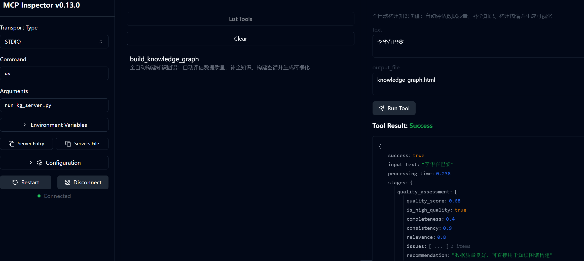
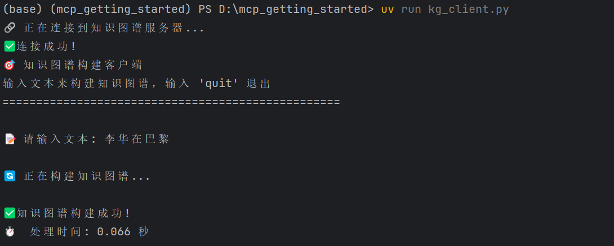
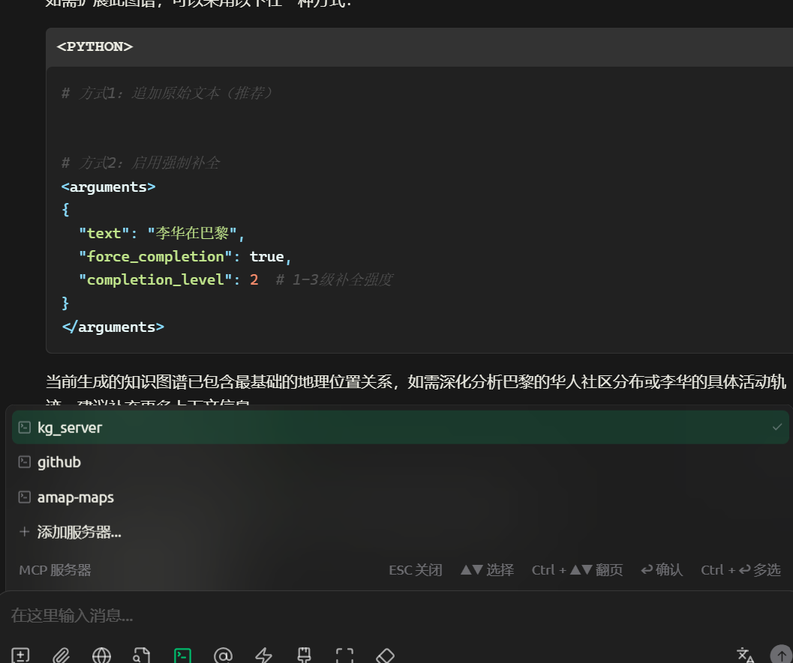

# MCP 知识图谱构建系统

这是一个基于 MCP (Model Context Protocol) 的升级版知识图谱构建系统，实现了三阶段的数据处理流水线：数据质量评估、知识补全和知识图谱构建。

## 系统特性

### 三阶段处理流程

1. **阶段1：数据质量评估**
   - 评估数据的完整性、一致性和相关性
   - 自动判断数据是否需要进一步处理
   - 提供详细的质量分析报告

2. **阶段2：知识补全与优化**（针对低质量数据）
   - 实体信息补全
   - 关系信息补全
   - 语义冲突修正
   - 格式规范化
   - 隐性知识推理（预留接口）

3. **阶段3：知识图谱构建**
   - 基于规则的三元组生成
   - LLM增强的知识图谱构建
   - 置信度计算
   - 交互式可视化

## 文件结构

```
kg_server.py    # 主要的 MCP 服务器
data_quality.py             # 数据质量评估模块
knowledge_completion.py      # 知识补全模块
kg_utils.py                 # 知识图谱构建工具
kg_client.py                # 测试客户端
kg_visualizer.py             # 可视化工具
```

## 快速开始

### 1. 安装依赖

```bash
uv sync
```

### 2. 配置环境变量

确保 `.env` 文件中有正确的配置，我这里使用的是silicon flow的API：

```env
OPENAI_API_KEY=your_api_key_here
OPENAI_BASE_URL=https://api.deepseek.com  # 或其他API端点
OPENAI_MODEL=deepseek-chat
```

### 2.1 LLMClient 机制说明

`content_enhancement/llm_client.py` 提供统一的大模型调用封装：

- 自动读取环境变量 `OPENAI_API_KEY`、`OPENAI_BASE_URL`，无需在代码中硬编码。
- 调用失败或未配置 API Key 时，将自动降级为本地模式，所有请求返回空结果。
- 模块集成方式：
  - `EntityDetailAnalyzer` 动态从 LLM 获取实体属性模板；若返回为空则使用默认硬编码模板。
  - `GlobalAnalyzer` 动态获取动词/因果关键词；若返回为空则使用默认集合。
- 内置缓存 (`functools.lru_cache`) 避免重复请求，降低成本。

### 2.2 运行单元测试

项目在 `tests/` 目录下提供了基础单元测试，验证 LLM 集成与回退逻辑：

```bash
python -m unittest discover -s tests -v
```

如需在 CI 中运行，可直接执行以上命令，无需外部依赖（测试使用 MockLLMClient）。

### 3. 启动服务器

```bash
uv run knowledge_graph_server.py
```

### 4. 运行测试
a. 在MCP Inspector中运行
```bash
npx -y @modelcontextprotocol/inspector uv run kg_server.py
```
之后点击MCP Inspector is up and running at后的链接在MCP Inspector进行查看。进入后点击connect，在上方选项中选择tools，在list tools中选择build_knowledge_graph，之后在左边输入文本即可生成。


b. 使用客户端代码运行
```bash
uv run kg_client.py
```
显示连接成功后输入文本，即可查看。


c. 使用主流MCP工具运行（如Cursor、Cherry Studio等）
示例：在Cherry Studio中运行
在设置中选择MCP服务器，点击添加服务器（从json导入），下面为配置json（注意修改本地地址）：
```
{
  "mcpServers": {
    "kg_server": {
      "command": "uv",
      "args": [
        "--directory",
        "D:/mcp_getting_started",
        "run",
        "kg_server.py"
      ],
      "env": {},
      "disabled": false,
      "autoApprove": []
    }
  }
}
```
之后开启该MCP服务器，就可以在Cherry Studio中使用了。

## 🛠️ MCP 工具接口

### 1. `assess_data_quality`
评估输入数据的质量

**参数：**
- `raw_data` (str): 原始数据

**返回：**
- 质量评估结果（JSON格式）

### 2. `complete_knowledge`
对低质量数据进行知识补全

**参数：**
- `raw_data` (str): 原始数据
- `quality_threshold` (float): 质量阈值，默认0.5

**返回：**
- 知识补全结果（JSON格式）

### 3. `build_knowledge_graph`
构建知识图谱

**参数：**
- `data` (str): 输入数据
- `use_llm` (bool): 是否使用LLM增强，默认True

**返回：**
- 知识图谱构建结果（JSON格式）

### 4. `process_data_pipeline`
完整的数据处理流水线

**参数：**
- `raw_data` (str): 原始数据
- `quality_threshold` (float): 质量阈值，默认0.5
- `use_llm` (bool): 是否使用LLM，默认True

**返回：**
- 完整流程处理结果（JSON格式）

### 5. `get_graph_statistics`
获取当前知识图谱统计信息

**返回：**
- 图谱统计信息（JSON格式）

## 使用示例

### 示例1：高质量数据
```
输入: "北京大学是中国著名的高等教育机构，位于北京市海淀区。"
处理: 直接进入阶段3构建知识图谱
输出: 
- 实体: [北京大学, 中国, 北京市, 海淀区]
- 三元组: [(北京大学, 位于, 海淀区), (海淀区, 位于, 北京市), ...]
```

### 示例2：低质量数据（信息不完整）
```
输入: "李华去巴黎"
处理: 
- 阶段1: 检测到信息不完整
- 阶段2: 补全"巴黎位于法国"
- 阶段3: 构建知识图谱
输出: 增强后的知识图谱
```

### 示例3：低质量数据（语义冲突）
```
输入: "巴黎市是德国城市。"
处理:
- 阶段1: 检测到语义冲突
- 阶段2: 修正为"巴黎是法国城市"
- 阶段3: 构建知识图谱
输出: 修正后的知识图谱
```

## 扩展功能

### 预留接口

1. **知识补全模型接口**
   - `_model_based_completion()` - 基于模型的知识补全
   - `_external_kb_query()` - 外部知识库查询

2. **LLM集成接口**
   - 可以集成真实的LLM API进行更智能的知识图谱生成
   - 支持多种LLM模型（GPT、Claude、DeepSeek等）

3. **知识库集成**
   - Wikidata
   - DBpedia
   - 企业内部知识库
   - 领域专用知识库

### 可扩展的评估指标

- 基于论文公式的质量评分
- 可用性（Usability）评估
- 相关性（Relevance）评估
- 置信度计算

## 技术特点

1. **模块化设计**：各个组件独立，易于扩展和维护
2. **异步处理**：支持高并发的数据处理
3. **置信度机制**：为每个三元组分配置信度分数
4. **错误处理**：完善的异常处理和错误恢复
5. **统计分析**：提供详细的图谱统计信息

## 性能优化

- 实体和关系的缓存机制
- 三元组去重和合并
- 批量处理支持
- 内存优化的图谱存储

## 贡献指南

1. Fork 项目
2. 创建功能分支
3. 提交更改
4. 推送到分支
5. 创建 Pull Request

## 许可证

MIT License

## 故障排除

### 常见问题

1. **端口占用错误**
   ```bash
   # 查找占用端口的进程
   netstat -ano | findstr :6277
   # 终止进程
   taskkill /PID <进程ID> /F
   ```

2. **API余额不足**
   - 检查 `.env` 文件中的API配置
   - 确认API账户有足够余额

3. **依赖安装问题**
   ```bash
   uv sync --reinstall
   ```

## 联系方式

如有问题或建议，请提交 Issue 或 Pull Request。
